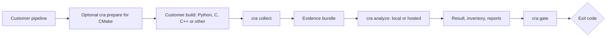

# CRA evidence platform

A CI-integrated tool that collects dependency evidence from a real build, reconciles it into one inventory, matches known vulnerabilities, explains each finding, and gives CI a clear outcome. It supports Cyber Resilience Act readiness work with traceable evidence.

It does not certify conformity, replace product testing, decide legal applicability, prove exploitability, or perform automatic root-cause analysis. It does not discover every dependency: it supports Linux projects through Python environment metadata, optional Conan 2/CMake evidence, selected filesystem directories, ELF artifacts and OCI images, and reports what it could not see.

Status: first version, on a development branch. See [the implementation audit](docs/PROJECT_AUDIT.md) and [what is verified and what is not](docs/IMPLEMENTATION_CHECKLIST.md) before relying on any part of it.

## How it works



| Outcome | Exit code | Meaning |
| --- | --- | --- |
| `passed` | 0 | Scan completed and policy passed |
| `policy_blocked` | 10 | Scan completed and policy blocked the build |
| `incomplete` | 20 | Scan incomplete, unsupported or failed. Never a clean result |
| Configuration failure | 30 | Fix the configuration or command |
| Authentication failure | 31 | Fix the token or signature trust |
| Operational failure | 32 | A failure in the tool or a service, not a product finding |

## Supported platforms

The `cra` command, the pinned tools and the container images run on **Linux only**, on x86-64 or ARM64. The machine that runs `cra` does not have to match the product: it reads ELF binaries of any CPU architecture, so firmware cross-compiled for ARM can be inspected from an x86-64 build machine.

| Where `cra` runs | Status |
| --- | --- |
| Linux, x86-64 (amd64) | Supported and tested: CLI, real-tool integration tests, container images and Compose |
| Linux, ARM64 (aarch64) | Supported. The installer and Dockerfiles select ARM64 builds of Syft, Grype and cosign; downloads, digests and binaries are verified. Not yet run on ARM64 hardware |
| Other Linux CPUs (32-bit ARM, ppc64le, s390x, RISC-V) | Not supported. The installer stops with exit 30 |
| Windows | Not supported natively: the CLI depends on Unix-only facilities and cannot start. Products that ship on Linux can be collected from Windows with the collector image under Docker Desktop or WSL2. Windows executables and DLLs are not inspected |
| macOS | Not supported natively and not tested; the installer stops with exit 30. Use the collector image. Mach-O binaries are not inspected |

Any Linux distribution with Python 3.11+ should work: the tools are static binaries. Tested on Kali (Debian-based), with Debian-based container images. RHEL, Alpine and SUSE are untested. This repository's own CI runs on GitHub's Ubuntu x86-64 runners; customers do not need Ubuntu.

## Install

Python 3.11 or newer on Linux (see [Supported platforms](#supported-platforms)). The collector, local engine and gate have no runtime dependencies.

```bash
python3 -m venv .venv
.venv/bin/pip install .            # the cra command
scripts/install_tools.sh           # pinned Syft, Grype and cosign in .tools/, digest-checked
.tools/grype db update             # vulnerability data; analysis itself never updates it
```

For the hosted service and tests, install the locked dependencies:

```bash
.venv/bin/pip install --require-hashes -r requirements/dev.lock
```

## Python, C, C++ and other projects

Collection is evidence-based, not selected by a language flag. Python uses captured `pip inspect` metadata; C/C++ use native build/artifact evidence; generic directory and container scans use Syft's package detectors. Conan and CMake are optional. See [language support and runnable configuration examples](docs/LANGUAGE_SUPPORT.md).

## Try it on the reference customer build

This builds a small real CMake and Conan project, then runs the whole path with real tools.

```bash
.venv/bin/pip install conan==2.34.0 cmake==4.4.4 ninja==1.13.2
reference/build_reference.sh       # runs cra prepare before CMake configures
curl --proto '=https' -fsSL https://www.cisa.gov/sites/default/files/feeds/known_exploited_vulnerabilities.json -o reference/out/kev.json

.venv/bin/cra collect --config reference/cra.toml
.venv/bin/cra analyze --config reference/cra.toml
.venv/bin/cra gate --result reference/out/cra/analysis --record reference/out/cra/gate.json
echo "exit code: $?"
```

The gate exits 10, because the final image has real unaddressed high-severity findings. Open `reference/out/cra/analysis/report.html` for the explanation of each one.

## Documentation

| Document | Contents |
| --- | --- |
| [Integration guide and CLI](docs/CLI.md) | Commands, configuration, policy, component records, VEX scope, schemas |
| [Architecture](docs/ARCHITECTURE.md) | Components and significant decisions |
| [Threat model](docs/THREAT_MODEL.md) | Assets, boundaries, controls and open risks |
| [Data flow and retention](docs/DATA_FLOW.md) | What leaves the customer, what is stored, for how long |
| [Hosted API](docs/HOSTED_API.md) | Endpoints, outage behaviour, local Docker Compose setup |
| [Updates and provenance](docs/PROVENANCE.md) | Hashes, signatures and provenance; signing, rotation, rollback |
| [Production requirements](docs/PRODUCTION.md) | What must change before real customer use, and known limitations |
| [Implementation checklist](docs/IMPLEMENTATION_CHECKLIST.md) | Each milestone: tested, mocked, unsupported or unverified |
| [Test results](docs/TEST_RESULTS.md) | Commands, results and measurements |
| [Pilot checklist](docs/PILOT_CHECKLIST.md) | What a customer pilot has to establish |

## Run the tests

```bash
python -m unittest discover tests                                        # deterministic, offline, fake scanners
CRA_INTEGRATION=1 python -m unittest discover -s tests/integration -t tests   # real Conan, CMake, Syft, Grype, cosign
```

# Earlier CRA readiness pipeline

The original report-based pipeline is preserved and still works. Its rules now live in `src/cra/readiness/`, and the new platform reuses them for readiness records. New integrations should use the `cra` command. The earlier report shows a readiness score; the new platform reports counts instead, so that no number can be read as a compliance percentage.

Collects and checks the engineering evidence the EU Cyber Resilience Act (Regulation (EU) 2024/2847) asks of a product manufacturer, using open-source tools in CI on every build.

The repository ships with demo data for the **DEMO-200 robot arm controller** by **Example Robotics GmbH**. Both are fictional, and so are the demo's triage decisions and risk assessment. The vulnerabilities in the sample data are real public CVEs for the listed component versions. To use your own product, see [Set up a real product](#set-up-a-real-product).

## Demo and live scans

The workflow separates the repeatable demo from the live scan. A third job handles the optional monitoring upload on an isolated runner.

| Job | Data | Result |
| --- | --- | --- |
| `demo` | A small, hand-picked sample of real CVEs, fixed to 5 November 2026 | Repeatable report for showing how the pipeline works. It does not show how many findings a real scan produces |
| `cra` | Live vulnerability data for the components declared in `firmware/` and `sbom/` | What a real scan finds. Most findings are not triaged |

The demo's triage only covers the sample, so its live scan can fail the gate. Live gate failures stop the build; the sample report remains available from the independent `demo` job. A manually dispatched candidate with `release_candidate: true` always runs the strict release gate before distribution.

Paragraph numbers below refer to the Commission guidance on the CRA, C(2026) 5252 annex, which is non-binding.

## What it does

| Step | Tool | CRA reference |
| --- | --- | --- |
| 1. SBOM from firmware sources | Syft (CycloneDX) | Annex I Part II (1) |
| 2. Manual components (kernel from BSP, closed vendor SDK) | `scripts/merge_sbom.py` | Annex I Part II (1) |
| 3. Match against known vulnerabilities | Grype | Annex I Part I (2)(a), Part II (2) |
| 4. Known-exploited check | CISA KEV catalogue | Article 14 reporting |
| 5. Triage decisions | OpenVEX (`vex/`) | Part II (2), technical documentation |
| 6. Readiness report + JSON evidence, CI gate | `scripts/cra_report.py` | Annex VII technical documentation |
| 7. Continuous monitoring after release | OWASP Dependency-Track (optional) | Part II (2), (3) |

## The score

The score is a readiness indicator, not proof of conformity. It is 70% Annex I checklist and 30% findings decided. A finding under investigation does not count as decided.

The checklist does not take claims at face value:

| Status in `product.json` | How it counts |
| --- | --- |
| `met` with `evidence_refs` to existing non-empty files | Met (full credit) |
| `met` with no evidence, or a missing file | Unverified (half credit) |
| `partial` | Half credit |
| `missing` | No credit |
| `not_applicable` with a reason in the risk assessment | Left out of the score (para 33) |
| `not_applicable` with no reason | Counted as missing |

Three items are checked from pipeline data, whatever `product.json` claims:

- **I.1** comes from the risk assessment (para 166).
- **I.2(a)** drops to partial while open findings have no release decision.
- **II.1** needs an SBOM that has components, all with versions.

Only a file's existence is checked, not its content, so someone still has to review the evidence.

## Security review

See [the security and production review](docs/SECURITY_REVIEW.md) for fixed issues, remaining production blockers and a recommended implementation order. The workflow now checks candidates before publication and never publishes releases or evidence automatically. See [production setup](docs/PRODUCTION_SETUP.md) for the controls still needed around product distribution.

## The gates

`--gate` runs on every build and fails on problems that must never wait:

- The KEV catalogue, the scan or the SBOM is unusable or empty.
- A known-exploited vulnerability has no triage decision.
- A VEX decision is rejected: `not_affected` needs a justification and a written impact statement, and `affected` needs an action statement.
- An investigation is older than `triage_policy.max_investigation_days`. The default of 14 is a project policy; the guidance asks for prompt action and sets no number of days (para 214).
- An Article 14 step is overdue, or the register is invalid.

`--release-gate` runs when you manually dispatch the workflow with `release_candidate: true`, and also requires:

- A complete risk assessment, market dates, a classification rationale and a support period of at least 5 years, or a reason for less (para 128).
- SBOM versions on every component.
- Every finding triaged, and a recorded release decision for each open one (para 237).
- For known-exploited findings, an answer on whether they are exploited in this product (para 218).
- For `affected` findings, the upstream reporting status (Article 13(6)).
- Impacted users informed for anything reportable (Article 14(8)).
- No `met` item without evidence, and no missing or partial checklist requirements.
- No open finding whose recorded decision requires fixing it before release.

The demo deliberately fails `--release-gate`. Its investigation of CVE-2022-0847 would pass the 14-day limit after 19 November 2026, so sample runs use `--date 2026-11-05` to stay repeatable.

## Large scans

A real scan can produce thousands of findings, especially for a Linux kernel declared by version alone. The report lists findings by component and shows the 200 highest-priority ones, with known-exploited findings first. `cra-summary.json` keeps every finding.

Reducing the number takes real product data: the exact kernel version and patch level, and recorded decisions for code the product does not build. A report limit does not remove any finding, and the gate still counts them all.

## Article 14 reporting

Register decisions for scanner findings must have the exact component `purl` (including version), as well as the vulnerability ID. Unscoped records remain visible as separate findings but cannot approve another component. Duplicate vulnerability/component records fail the gate.

`vuln/register.json` records vulnerabilities from any source, including ones a scanner cannot see: researchers, customers, your own tests and the media (paras 233-234). Those also appear as findings.

A KEV listing alone does not start the clock. Exploitation must be in your product (para 218), and the clock runs from when you have reasonable certainty (para 213). Awareness before 11 September 2026 needs no retroactive report (para 217). Once you set `actively_exploited_in_product: true` and `aware_at`, or add an `incident` entry, the report tracks:

- Early warning within 24 hours.
- Notification within 72 hours.
- Final report 14 days after a fix for a vulnerability, or one month after the notification for an incident.

Reporting itself happens on the ENISA Single Reporting Platform; this tool only tracks the deadlines.

## Run it locally with the sample data

Python 3.10+ only, no packages needed.

```bash
python scripts/cra_report.py \
  --product product.json \
  --sbom sample-data/sbom.syft.cdx.json \
  --manual sbom/manual-components.cdx.json \
  --scan sample-data/scan.grype.json \
  --vex vex/demo200.openvex.json \
  --kev sample-data/kev.json \
  --risk risk/risk-assessment.json \
  --register vuln/register.json \
  --out out/cra-report.html --summary out/cra-summary.json \
  --sample --date 2026-11-05 --gate
```

Run the tests with `python -m unittest discover tests`.

Open `out/cra-report.html` in a browser.

## Run it for real

Push this repository to GitHub. Pushes, pull requests and a six-hour schedule run the build gate. Use Actions → CRA pipeline → Run workflow and select `release_candidate` for the strict gate before distributing a candidate. The workflow in `.github/workflows/cra-pipeline.yml` installs Syft and Grype, scans `firmware/conanfile.txt`, fetches the live KEV catalogue and builds the report. Download it from the run's artifacts. Results from the live vulnerability database can differ from the sample data.

## Set up a real product

1. Copy `templates/` into your repository: `product.json`, `risk-assessment.json`, `register.json` and `openvex.json`.
2. Do the risk assessment first. It decides which Part I requirements apply (para 33), and cost or risk appetite cannot justify leaving a risk unaddressed (paras 158, 163).
3. Decide whether your product has remote data processing, such as a cloud service it needs for one of its functions (section 8).
4. Fill in `product.json`, including `classification_rationale`, `market` and the support period. Link evidence files through `evidence_refs`, with paths relative to `product.json`.
5. At the top of `.github/workflows/cra-pipeline.yml`, set the product paths. Set `demo` to `false` in `product.json` if you started from the demo file.
6. Replace step 1 with an SBOM from your real firmware, using the options below.

- **Yocto:** replace step 1 with the SBOM from `create-spdx`, converted to CycloneDX. Extract the image's `.spdx.tar.zst` first, then run `python scripts/spdx_to_cdx.py <extracted dir> --name <image> -o out/sbom.cdx.json`. SPDX 3 is not supported, so on releases that default to it use `INHERIT += "create-spdx-2.2"`.
- **Zephyr:** replace step 1 with `west spdx`, then run `python scripts/spdx_to_cdx.py <build dir>/spdx --name <app> -o out/sbom.cdx.json`.
- **After converting:** read the converter's warnings. A component with no version cannot be matched to CVEs. The workflow runs Grype with `--add-cpes-if-none` so that components with no CPE are still checked; generated CPEs can add false matches, which you record in VEX.
- **Containers or root filesystems:** `syft scan <image or dir>`.
- Keep the pinned Syft and Grype versions and SHA-256 digests in the install step reviewed together. Dependabot proposes updates to action commit pins.
- The workflow explicitly generates `cyclonedx-json@1.5` to match the manual SBOM. When changing schema versions, update every input together; the merger rejects mismatches. See [Syft format versions](https://oss.anchore.com/docs/guides/sbom/formats/#format-versions).
- Edit `product.json` with the product's Annex I self-assessment and `vex/*.openvex.json` with triage decisions.

## Keeping the evidence

Every run uploads CI artifacts with 90-day retention. No evidence is attached to public releases automatically. Artifact visibility follows repository access, so use a private repository for confidential incident and vulnerability records.

The `out/evidence/` snapshot includes input files, tool/database provenance, linked evidence and a SHA-256 manifest with the source commit. `cra-summary.json` records gate mode, result and failure reasons. A failed snapshot fails the workflow; raw diagnostics may still be retained in `out/` and must not be treated as a complete bundle.

Copy successful candidate bundles into manufacturer-controlled long-term storage before artifact expiry. Hashes alone do not authenticate an archive; signing and protected retention remain deployment responsibilities. The optional `--firmware` argument to `scripts/cra_evidence.py` retains and hashes an actual built firmware file. It does not prove that the SBOM describes that image.

## Files

```
product.json                     product data and Annex I checklist status
risk/risk-assessment.json        cybersecurity risk assessment (demo)
vuln/register.json               vulnerability and incident register (demo)
templates/                       blank files for a real product
firmware/conanfile.txt           example dependencies the scanner finds
sbom/manual-components.cdx.json  components the scanner cannot see
vex/demo200.openvex.json           triage decisions with justifications
sample-data/                     offline SBOM, scan and KEV subset for the demo
scripts/cra_report.py            report generator
scripts/cra_checks.py            score, evidence, register and gate rules
scripts/cra_validation.py        canonical checklist and structural checks
scripts/cra_evidence.py          evidence snapshots and SHA-256 manifest
scripts/merge_sbom.py            SBOM merge helper
scripts/spdx_to_cdx.py           SPDX 2.x to CycloneDX converter for Yocto and Zephyr
tests/                           tests for the converter, checks and gates
.github/workflows/               the CI pipeline
```

## Limits

This pipeline produces technical evidence and checks that records exist and agree with each other. It cannot judge whether a risk assessment or a triage decision is right, and it does not yet test the device itself, so most Part I requirements still rest on evidence you supply. It is not legal advice. The manufacturer stays responsible for the risk assessment, the EU declaration of conformity and CE marking.

Not covered yet: component due diligence (Article 13(5)), checks for substantial modifications, tracking certificates under other laws, firmware and code scanning, and device testing.
