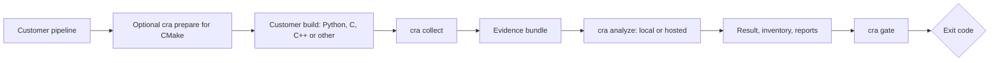

# CRA evidence platform

A CI-integrated tool that collects dependency evidence from a real build, reconciles it into one inventory, matches known vulnerabilities, explains each finding, and gives CI a clear outcome. It supports Cyber Resilience Act readiness work with traceable evidence.

It does not certify conformity, replace product testing, decide legal applicability, prove exploitability, or perform automatic root-cause analysis. It does not discover every dependency: it supports Linux projects through Python environment metadata, optional Conan 2/CMake evidence, selected filesystem directories, ELF artifacts and OCI images, and reports what it could not see.

Status: first version, on a development branch. See [the implementation audit](docs/PROJECT_AUDIT.md) and [what is verified and what is not](docs/IMPLEMENTATION_CHECKLIST.md) before relying on any part of it.

## How it works



| Outcome | Exit code | Meaning |
| --- | --- | --- |
| `passed` | 0 | Scan completed and policy passed |
| `policy_blocked` | 10 | Scan completed and policy blocked the build |
| `incomplete` | 20 | Scan incomplete, unsupported or failed. Never a clean result |
| Configuration failure | 30 | Fix the configuration or command |
| Authentication failure | 31 | Fix the token or signature trust |
| Operational failure | 32 | A failure in the tool or a service, not a product finding |

## Supported platforms

The `cra` command, the pinned tools and the container images run on **Linux only**, on x86-64 or ARM64. The machine that runs `cra` does not have to match the product: it reads ELF binaries of any CPU architecture, so firmware cross-compiled for ARM can be inspected from an x86-64 build machine.

| Where `cra` runs | Status |
| --- | --- |
| Linux, x86-64 (amd64) | Supported and tested: CLI, real-tool integration tests, container images and Compose |
| Linux, ARM64 (aarch64) | Supported and tested under QEMU emulation: installer, routine tests, container images and Compose, with results identical to x86-64. Not yet run on physical ARM64 hardware |
| Other Linux CPUs (32-bit ARM, ppc64le, s390x, RISC-V) | Not supported. The installer stops with exit 30 |
| Windows | Not supported natively: the CLI depends on Unix-only facilities and cannot start. Products that ship on Linux can be collected from Windows with the collector image under Docker Desktop or WSL2. Windows executables and DLLs are not inspected |
| macOS | Not supported natively and not tested; the installer stops with exit 30. Use the collector image. Mach-O binaries are not inspected |

Any Linux distribution with Python 3.11+ should work: the tools are static binaries. Tested on Kali (Debian-based), with Debian-based container images. RHEL, Alpine and SUSE are untested. This repository's own CI runs on GitHub's Ubuntu x86-64 runners; customers do not need Ubuntu.

## Install

Python 3.11 or newer on Linux (see [Supported platforms](#supported-platforms)). The collector, local engine and gate have no runtime dependencies.

```bash
python3 -m venv .venv
.venv/bin/pip install .            # the cra command
scripts/install_tools.sh           # pinned Syft, Grype and cosign in .tools/, digest-checked
export PATH="$PWD/.tools:$PATH"    # cra runs syft and grype from PATH
```

`cra` looks for `syft` and `grype` on `PATH`. Either keep `.tools/` on `PATH` as above, or set absolute or project-relative paths in the configuration under `[tools]` (`syft = "/opt/cra/.tools/syft"`, `grype = "/opt/cra/.tools/grype"`). Fetch vulnerability data with `cra data update` (below). It needs several GiB of free space for the Grype database; analysis itself never updates it.

For the hosted service and tests, install the locked dependencies:

```bash
.venv/bin/pip install --require-hashes -r requirements/dev.lock
```

## Generate your config

Run in the product repository (or pass `--root`). Static detection does not execute build files or claim complete discovery.

```bash
cra init --name my-product --version 1.2.3 --supplier 'My organisation' --dry-run
cra init --name my-product --version 1.2.3 --supplier 'My organisation'
cra validate --config cra.toml
cra data update --config cra.toml
# Review generated records, capture actual build evidence, then collect/analyze/gate.
```

Existing files require merge-only `--force`; use `--author` to select trusted VEX authors explicitly. SDK roots, CPE mappings, test framework settings, strict policy, readiness templates and detector limitations are documented in [Generate your configuration](docs/INITIALIZATION.md).

## Python, C, C++ and other projects

Collection is evidence-based, not selected by a language flag. Python uses captured `pip inspect` metadata; C/C++ use native build/artifact evidence; generic directory and container scans use Syft's package detectors. Conan and CMake are optional. See [language support and runnable configuration examples](docs/LANGUAGE_SUPPORT.md).

## Try it on the reference customer build

This builds a small real CMake and Conan project, then runs the whole path with real tools.

```bash
.venv/bin/pip install conan==2.34.0 cmake==4.4.4 ninja==1.13.2
poc/reference/build_reference.sh       # runs cra prepare before CMake configures
curl --proto '=https' -fsSL https://www.cisa.gov/sites/default/files/feeds/known_exploited_vulnerabilities.json -o poc/reference/out/kev.json

.venv/bin/cra collect --config poc/reference/cra.toml
.venv/bin/cra analyze --config poc/reference/cra.toml
.venv/bin/cra gate --result poc/reference/out/cra/analysis --record poc/reference/out/cra/gate.json
echo "exit code: $?"
```

The gate exits 10, because the final image has real unaddressed high-severity findings. Open `poc/reference/out/cra/analysis/report.html` for the explanation of each one.

## Documentation

| Document | Contents |
| --- | --- |
| [Configuration generation](docs/INITIALIZATION.md) | Detection, init, validation, mappings, policy templates and safe reruns |
| [Integration guide and CLI](docs/CLI.md) | Commands, configuration, policy, component records, VEX scope, schemas |
| [Architecture](docs/ARCHITECTURE.md) | Components and significant decisions |
| [Threat model](docs/THREAT_MODEL.md) | Assets, boundaries, controls and open risks |
| [Data flow and retention](docs/DATA_FLOW.md) | What leaves the customer, what is stored, for how long |
| [Hosted API](docs/HOSTED_API.md) | Endpoints, outage behaviour, local Docker Compose setup |
| [Updates and provenance](docs/PROVENANCE.md) | Hashes, signatures and provenance; signing, rotation, rollback |
| [Production requirements](docs/PRODUCTION.md) | What must change before real customer use, and known limitations |
| [Implementation checklist](docs/IMPLEMENTATION_CHECKLIST.md) | Each milestone: tested, mocked, unsupported or unverified |
| [Test results](docs/TEST_RESULTS.md) | Commands, results and measurements |
| [Pilot checklist](docs/PILOT_CHECKLIST.md) | What a customer pilot has to establish |

## Run the tests

```bash
python -m unittest discover tests                                        # deterministic, offline, fake scanners
CRA_INTEGRATION=1 python -m unittest discover -s tests/integration -t tests   # real Conan, CMake, Syft, Grype, cosign
```

## Repository layout

```text
src/cra/          Scanner product: collector, analysis, gate, hosted service and packaged resources
poc/              Demonstrations and experiments, separate from the shipped product
  legacy/         Original DEMO-200 pipeline, scripts, sample data and example reports
  reference/      Representative C/C++ customer application and build/image setup
tests/            All automated verification
  legacy/         Original proof-of-concept regression tests
  integration/    Opt-in checks using real tools
  fixtures/       Deterministic inputs and captured scanner output
examples/         Reusable customer configurations and CI examples
deploy/           Product Dockerfiles and local service deployment
scripts/          Product tooling: scanner installation and release building
requirements/     Locked development/service dependencies
docs/             Architecture, security, integration and operating guides
```

See [folder ownership and migration details](docs/REPOSITORY_LAYOUT.md). The [legacy demo guide](poc/legacy/README.md) describes the original report pipeline. New customer integrations should use the `cra` CLI. The [reference application](poc/reference/README.md) is PoC material used by real-tool integration tests, not a scanner runtime dependency.

## Contributing

Contributions are welcome. Read [CONTRIBUTING.md](CONTRIBUTING.md) before opening a pull request, and report security problems privately as described in [SECURITY.md](SECURITY.md).

## License

Released under the [MIT License](LICENSE). Copyright (c) 2026 Abraham Joji.
If you use or redistribute this code, keep the copyright notice and license text.
