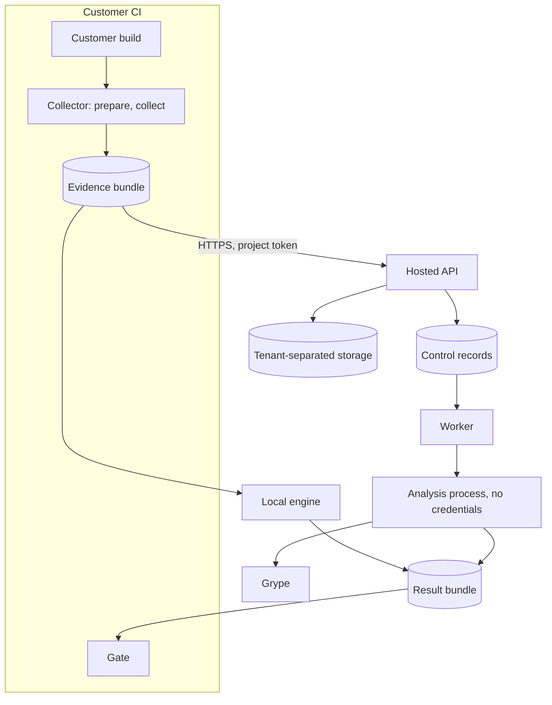

# Architecture

For engineers working on or reviewing the platform.

## Components

| Concern | Code | Notes |
| --- | --- | --- |
| Build metadata collection | `cra/collector/` | Parses output of tools the customer already ran |
| Inventory normalization and reconciliation | `cra/engine/reconcile.py` | Keeps states, conflicts and sources separate |
| Scanner adapters | `cra/collector/container.py` (Syft), `cra/engine/grype.py` | Narrow; pin version and output handling together |
| VEX and triage | `cra/engine/vex.py` | Exact scope, author allow-list |
| Policy | `cra/engine/policy.py` | Evaluates both gate modes |
| Evidence and provenance | `cra/common/bundle.py` | Raw output retained, SHA-256 manifests |
| Reports and gate | `cra/engine/report.py`, `cra/gate.py` | The gate needs no engine |
| Hosted API and workers | `cra/hosted/` | Optional |
| CRA readiness | `cra/readiness/`, `cra/engine/readiness.py` | Reused rules; reports counts, not a percentage |

## Significant decisions

**Python with no runtime dependencies for the collector, engine and gate.** The collector runs inside customer CI, so every dependency is customer attack surface. The standard library now covers TOML, tar, hashing and HTTP. Only the hosted service has dependencies (FastAPI, uvicorn), locked with hashes.

**Existing scanners behind narrow adapters.** Syft and Grype do package identification and matching. This tool adds what they lack: build-aware reconciliation, provenance, explanation and policy. A scanner version outside the verified set makes the result unsupported unless explicitly allowed.

**The collector parses; it never builds.** It reads Conan's JSON and CMake's File API replies from the customer's real build. It does not resolve dependencies itself, and it reads recipes with `ast`, without executing them.

**Identity comes from evidence, not from names.** A CMake link path identifies a package only when it falls inside a package folder named by the Conan graph for the same configuration. A target called `ZLIB::ZLIB` proves nothing by itself.

**Separate states, one inventory.** Declared, resolved, observed and shipped are separate facts. In the reference build, Conan resolved `lz4` while a build flag left it unlinked, which is why resolved cannot mean shipped.

**Three shipped values.** `yes` needs positive evidence. `no` needs positive evidence too: Conan's build or test context, or absence from a complete final image inventory. Everything else is `unknown`, and `unknown` blocks by default.

**Generic evidence attaches only when it agrees.** A version string found in a binary joins the Conan component only at the same version. Otherwise both stay, with a conflict. Debian's `zlib1g` and Conan's `zlib` are never merged, because they are different builds with different patches.

**No match is not clean.** Conan packages have no feed of their own, so curated CPE hints connect some of them to NVD. Reference testing confirmed that without a CPE, Conan packages get zero matches. Anything no feed can match is listed in `not_matchable`.

**Grype gets the original Syft document for images.** That keeps the distribution identity, so Grype uses the distribution's own feed, including its backport data.

**The gate decides from a stored evaluation.** `cra analyze` evaluates both modes, and `cra gate` selects one and checks integrity and binding. So the gate cannot rescan with different inputs, and proprietary policy logic stays with the engine.

**Hosted analysis works on evidence only.** The worker parses JSON and runs Grype over an SBOM. It never runs customer CMake files or Conan recipes. This is what makes hosted analysis possible without customer build infrastructure.

**SQLite and a local filesystem in this version.** They keep the first version to two processes and no extra services. They are not a production choice; see [PRODUCTION.md](PRODUCTION.md).

**Bearer project tokens, hashed.** Tokens are 256-bit random values stored as SHA-256, generated with `secrets`. No custom cryptography is used. Production should move CI to OIDC workload identity.

**Cosign for release signing.** An established tool, with key-based and keyless modes.

## Reused from the earlier pipeline

| Reused | Where |
| --- | --- |
| Annex I checklist, risk assessment, register and Article 14 rules | `cra/readiness/checks.py`, `validation.py`, called from `cra/engine/readiness.py` |
| VEX content rules | `checks.vex_problem` in `cra/engine/vex.py` |
| Scanner pins and digests | `scripts/install_tools.sh`, Dockerfiles |
| Isolated credential job pattern | `examples/github-actions/cra.yml` |
| HTML escaping and link rules | Same approach in `cra/engine/report.py` |

## Not carried into the new path

| Earlier behaviour | New behaviour |
| --- | --- |
| Unbounded JSON loading | Size and depth limits |
| SBOM merge raises on any conflict | Conflicts are kept as records |
| Scanning source declarations only | Evidence from the actual build and outputs |
| One gate exit code for every failure | Distinct documented outcomes |
| Percentage readiness score | Counts by status |
| `--add-cpes-if-none` on by default | Curated hints; generated CPEs are opt-in |
| KEV or scan problems as gate failures | Incomplete, kept separate from product findings |
| VEX `products` always read as the component | Product and subcomponent forms, with exact scope |

The earlier scripts in `scripts/` still work unchanged, and their limits are in [SECURITY_REVIEW.md](SECURITY_REVIEW.md).
