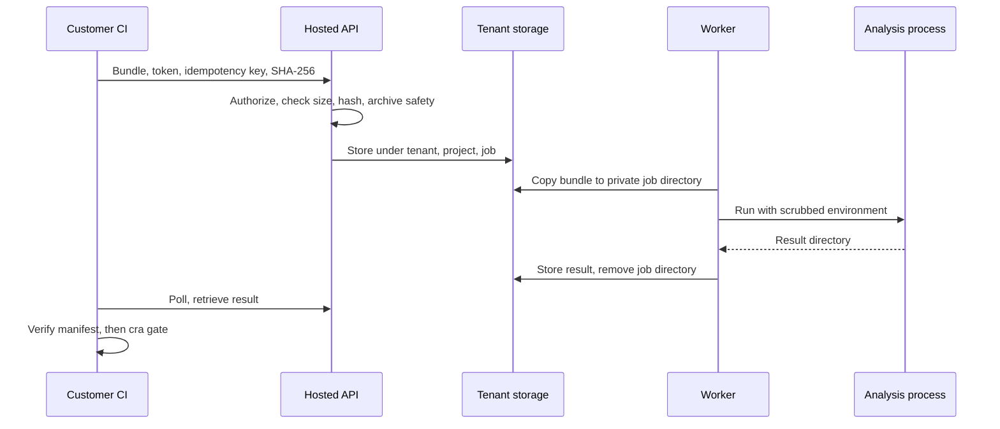

# Data flow and retention

For customers' security and privacy reviewers, and for operators.

## What stays on the customer side

- Source code. It is not uploaded by default, and no option uploads it.
- Built binaries and image archives. Only hashes and extracted facts leave.
- Conan recipes. They are parsed locally and only their hash is retained.

## What a hosted submission contains

The upload is the `collection/` directory plus any VEX files. Inventories and metadata can themselves be confidential. Review a real bundle before enabling uploads: it is an ordinary directory.

| Data | Contains | Sensitivity |
| --- | --- | --- |
| Conan graph | Package names, versions, options, settings, absolute build paths | Reveals dependencies, and usernames in paths |
| CMake replies | Target names, **source file names**, compile flags, link lines, absolute paths | Reveals project structure |
| CMake cache | Only allow-listed entries such as `CMAKE_BUILD_TYPE` and `*_DIR` | Low |
| Syft documents | Packages and file locations in images | Reveals image contents |
| Artifact facts | File names, hashes, needed libraries, version strings | Reveals components |
| Component records | Vendor components, patch claims, reviewer names | Can be commercially sensitive |
| VEX | Vulnerability decisions and reasoning | Sensitive: reveals known weaknesses |

Redaction runs on retained evidence: secret-named keys, token patterns, URL credentials and `*TOKEN*=value` assignments. It is pattern-based, so it reduces risk and cannot guarantee removal. Absolute paths are not rewritten in this version.

## Flow

## Storage

| Data | Location | Default lifetime | Removal |
| --- | --- | --- | --- |
| Local bundle and results | `output.dir` in the workspace | Until the CI workspace is cleaned | Customer |
| Hosted bundle | `tenants/<tenant>/<project>/<job>/bundle.tar.gz` | Project retention, default 90 days | `DELETE /v1/jobs/{id}`, or automatic purge |
| Hosted result | Same directory, `result.tar.gz` | Same | Same |
| Job scratch directory | Temporary, per job | Length of the job | Automatic |
| Token | SHA-256 hash only | Until revoked or expired, default 90 days | `cra-server revoke-token` |
| Job record | Control database | Kept, marked deleted | Operator |
| Audit record | Control database | Kept | Operator. No automatic expiry in this version |

Vulnerability databases and the KEV catalogue are public data, shared between jobs and read-only to the worker. No tenant data goes in them.

## Deletion

- `DELETE /v1/jobs/{id}` removes the bundle and result immediately, and an audit record remains. It needs the `delete` scope.
- If a job is deleted during analysis, the deletion wins and the result is discarded.
- Retention runs on each worker cycle and with `cra-server purge-expired`.
- Deletion removes files from the filesystem. It does not cover backups or storage-level snapshots, which production must handle.

## Audit

Records cover tenant, project and token creation, revocation, denied requests, submissions, rejections, job results, result reads, deletions and retries. A project token can read its own project's records through `GET /v1/audit`. Audit records are ordinary database rows and are not tamper-evident in this version.

## Local mode

`cra analyze` without `--hosted` makes no upload. It contacts nothing by itself: Grype's database update is a separate command, and auto-update is disabled during analysis.
